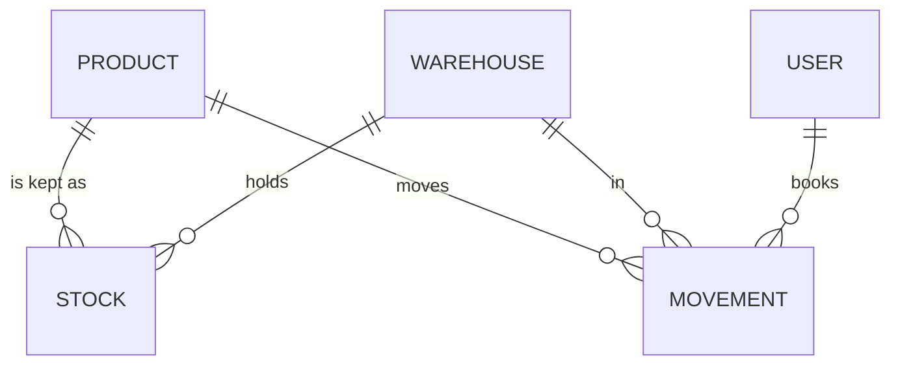

# Domain

A mini warehouse: a user keeps a list of products and warehouses, books goods in (receipt) and out (issue), and sees
the stock per product and warehouse with the history of movements. Stock changes only through a movement.

## Entities

| Entity | Fields (logical types) | Rules |
|---|---|---|
| User | id (uuid), username (text, unique), password hash (text), role (text: `app_user`), created at (timestamp) | password never returned |
| Product | id (uuid), SKU (text, unique, upper-case, 1–32), name (text, 1–200), unit (text: `pcs`, `kg`, `m`, `l`), created at, updated at | SKU unique whatever the case |
| Warehouse | id (uuid), code (text, unique, upper-case, 1–16), name (text, 1–200), created at, updated at | |
| Stock | product id, warehouse id (key), quantity (decimal ≥ 0), updated at | changed only by a movement |
| Movement | id (uuid), kind (`receipt` / `issue`), product id, warehouse id, quantity (decimal > 0), note (text, optional), created by (username), created at | append-only |

## Operations (the `api` schema)

| Operation | PostgREST | Rule |
|---|---|---|
| Sign in | `POST /rpc/login` | `web_anon` may call only this |
| Products list / create / edit | `GET/POST/PATCH /products` (updatable view) | SKU unique, unit from the list |
| Warehouses list / create / edit | `GET/POST/PATCH /warehouses` | code unique |
| Stock | `GET /stock` (view with product and warehouse names) | read-only |
| Movements | `GET /movements` (view) | read-only |
| Receive | `POST /rpc/receive` | quantity > 0; creates the stock row if missing |
| Issue | `POST /rpc/issue` | quantity > 0; locks the stock row; fails when stock < quantity |

## Example (invented data)

1. User `demo` signs in.
2. Warehouses: `MAIN` "Main warehouse", `EAST` "East depot".
3. Products: `BOLT-M8` "Hex bolt M8" (pcs), `CABLE-3X1.5` "Power cable 3×1.5" (m).
4. Receipt: 500 pcs `BOLT-M8` into `MAIN`, note "Delivery 2026-11-13" → stock `BOLT-M8 / MAIN` = 500.
5. Issue: 120 pcs `BOLT-M8` from `MAIN` → stock 380; movements show both lines by `demo`.
6. Issue: 400 pcs `BOLT-M8` from `MAIN` → refused ("Not enough stock: 380 available"), stock stays 380.
